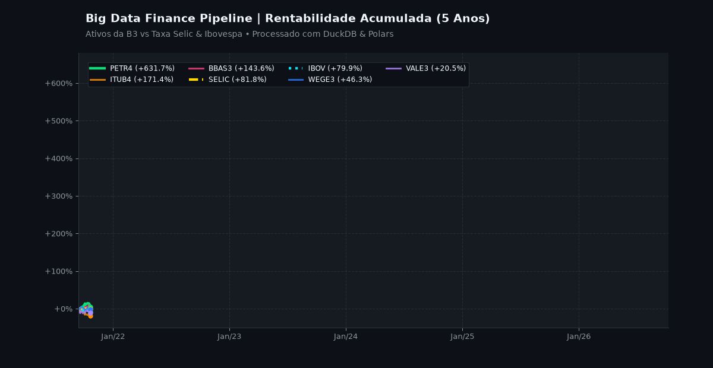
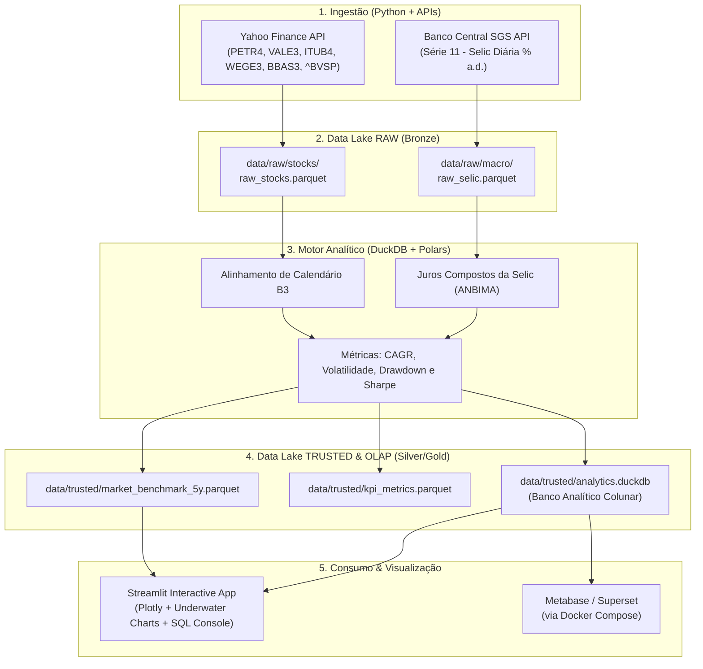

<div align="center">

# 📊 Big Data Finance Pipeline

### *Modern Data Stack Open Source para Análise Financeira Quantitativa e Macroeconômica*

[](https://www.python.org/)
[](https://duckdb.org/)
[](https://pola.rs/)
[](https://parquet.apache.org/)
[](https://streamlit.io/)
[](https://www.docker.com/)
[](LICENSE)

<br/>

<!-- Banner Animado do Dashboard -->
<p align="center">
  
</p>

> **Data Engineering Pipeline:** Comparativo histórico de 5 anos entre Ativos da B3 (Ações) e Indicadores Macroeconômicos (Selic/Ibovespa) usando Python e arquitetura Open Source.

</div>

---

## 📌 Sumário

* [💼 O Problema que Resolvemos (Business Value)](#-o-problema-que-resolvemos)
* [🏆 Resultados do Benchmark (5 Anos)](#-resultados-do-benchmark-5-anos)
* [🏛️ Arquitetura da Solução (Medallion Lakehouse)](#%EF%B8%8F-arquitetura-da-solu%C3%A7%C3%A3o)
* [🗄️ Estrutura do Data Lake](#%EF%B8%8F-estrutura-do-data-lake)
* [📐 Metodologia Quantitativa](#-metodologia-quantitativa)
* [🚀 Guia de Inicialização Rápida](#-guia-de-inicializa%C3%A7%C3%A3o-r%C3%A1pida)
* [🤝 Vamos conversar? (Consultoria B2B)](#-vamos-conversar)

---

## 💼 O Problema que Resolvemos

No mercado financeiro e no varejo corporativo, gestores perdem semanas de trabalho por ano tentando cruzar bases de dados enormes em planilhas que travam.

Este projeto é uma **Prova de Conceito (PoC)** que demonstra como solucionar esse gargalo. Construímos uma esteira de dados (*Data Pipeline*) 100% automatizada que extrai, processa e entrega insights financeiros complexos em milissegundos. Tudo isso **sem depender de licenças caras de software proprietário** (Zero custo de Power BI ou instâncias caras de nuvem).

---

## 🏆 Resultados do Benchmark (5 Anos)

*Período: Setembro/2021 a Outubro/2026 (Dados reais extraídos via pipeline)*

O painel final responde perguntas instantâneas de risco e retorno cruzando ações da B3 com o histórico diário oficial do BACEN:

| Ativo | Nome | Retorno Total | CAGR Anual | Volatilidade | Max Drawdown | Índice Sharpe |
| :--- | :--- | :---: | :---: | :---: | :---: | :---: |
| **PETR4.SA** | Petrobras PN | <span style="color:#0ecb81">**+631.69%**</span> | **+48.10%** | 31.52% | -39.10% | **1.13** |
| **ITUB4.SA** | Itaú Unibanco PN | <span style="color:#0ecb81">**+171.36%**</span> | **+21.77%** | 25.22% | -28.43% | **0.37** |
| **BBAS3.SA** | Banco do Brasil ON | <span style="color:#0ecb81">**+143.60%**</span> | **+19.21%** | 27.81% | -37.65% | **0.24** |
| **SELIC** | Taxa Selic Acumulada | <span style="color:#f0b90b">**+81.75%**</span> | **+12.51%** | 0.00% | 0.00% | *Risk-Free* |
| **^BVSP** | Ibovespa | <span style="color:#00bcd4">**+79.95%**</span> | **+12.29%** | 17.83% | -20.93% | -0.01 |
| **WEGE3.SA** | WEG ON | <span style="color:#0ecb81">**+46.32%**</span> | **+7.80%** | 29.95% | -44.25% | -0.16 |
| **VALE3.SA** | Vale ON | <span style="color:#0ecb81">**+20.45%**</span> | **+3.74%** | 29.28% | -38.15% | -0.30 |

---

## 🏛️ Arquitetura da Solução

Esta arquitetura utiliza **Polars** e **DuckDB** para processar centenas de milhares de pontos de dados localmente ou em containers (Docker), persistindo tudo no padrão **Medallion Architecture (Bronze/Raw ➔ Silver/Trusted ➔ Gold/Analytics)** em formato colunar comprimido **Apache Parquet (Zstandard)**.



---

## 🗄️ Estrutura do Data Lake

Organizado no padrão de camadas de maturidade analítica:

```text
data/
├── raw/                                     # Camada Bronze: dados brutos preservados
│   ├── stocks/
│   │   └── raw_stocks.parquet               # Histórico OHLCV da B3 (yfinance)
│   └── macro/
│       └── raw_selic.parquet                # Histórico diário oficial do BACEN
│
└── trusted/                                 # Camada Silver/Gold: dados tratados & métricas
    ├── market_benchmark_5y.parquet          # Tabela unificada alinhada (8.800+ registros)
    ├── kpi_metrics.parquet                  # Indicadores consolidados por ativo
    └── analytics.duckdb                     # Banco analítico DuckDB pronto para SQL
```

---

## 📐 Metodologia Quantitativa

1. **Alinhamento Temporal:** A Taxa Selic e as ações da B3 compartilham o mesmo calendário de dias úteis, garantindo uma base fidedigna de comparação.
2. **Juros Compostos da Selic (BACEN / ANBIMA):**
   $$\text{Fator Diário}_t = 1 + \frac{\text{taxa\_selic}_t}{100}$$
   $$\text{Fator Acumulado}_T = \prod_{t=1}^T \text{Fator Diário}_t$$
3. **Normalização em Base 100:** Todos os ativos partem do mesmo índice $100.0$ na primeira data de negociação do período.
4. **Métricas de Risco Calculadas:**
   * **CAGR (Taxa Composta Anual):** $(1 + R_{total})^{1/\text{anos}} - 1$
   * **Volatilidade Anualizada:** $\sigma_{\text{diário}} \times \sqrt{252}$
   * **Max Drawdown:** $\min_{t} \left( \frac{P_t}{\max_{s \le t} P_s} - 1 \right)$
   * **Índice Sharpe Simples:** $\frac{\text{CAGR}_{\text{ativo}} - \text{CAGR}_{\text{Selic}}}{\text{Volatilidade Anualizada}}$

---

## 🚀 Guia de Inicialização Rápida

### 1. Gerenciador de Pacotes (`uv`)
Este projeto é otimizado para o **[uv](https://github.com/astral-sh/uv)** (gerenciador ultra-rápido de Python escrito em Rust):

```bash
git clone https://github.com/mmelquii-dev/analise-b3.git
cd analise-b3
uv sync
```

### 2. Execução via CLI (`main.py`)
A aplicação conta com uma interface de linha de comando integrada:

```bash
# 1. Checar integridade das camadas do Data Lake
uv run python main.py status

# 2. Executar pipeline ponta a ponta (Ingestão + Processamento)
uv run python main.py pipeline

# 3. Iniciar o Dashboard Interativo
uv run python main.py dashboard
# Abra no navegador: http://localhost:8501

# 4. Rodar queries SQL diretas no DuckDB via terminal
uv run python main.py query "SELECT ticker, retorno_total_pct, sharpe_ratio FROM kpi_metrics ORDER BY retorno_total_pct DESC"
```

### 3. Infraestrutura Docker
Para subir o **MinIO** e o **Metabase** em containers:

```bash
docker compose -f docker/docker-compose.yml up -d
```

* **MinIO Console:** [http://localhost:9001](http://localhost:9001) (`minioadmin` / `minioadminpassword`)
* **Metabase BI:** [http://localhost:3000](http://localhost:3000)

---

## 🤝 Vamos conversar?

Você sente que a sua empresa está perdendo tempo (e dinheiro) gerando relatórios manuais e dependendo de planilhas lentas?

Essa infraestrutura de Big Data Open Source pode ser acoplada diretamente ao sistema de vendas, estoque ou ERP do seu negócio, garantindo métricas atualizadas no seu celular todo dia de manhã, com segurança e isolamento total dos seus dados.

👉 **[Clique aqui para conectar no LinkedIn](https://www.linkedin.com/in/melquisedeque-dos-santos)** e vamos agendar um bate-papo de 15 minutos para descobrirmos como destravar os dados da sua empresa.

---

<div align="center">
Desenvolvido por <b>Melquisedeque dos Santos (mmelquii-dev)</b> 🚀
</div>
