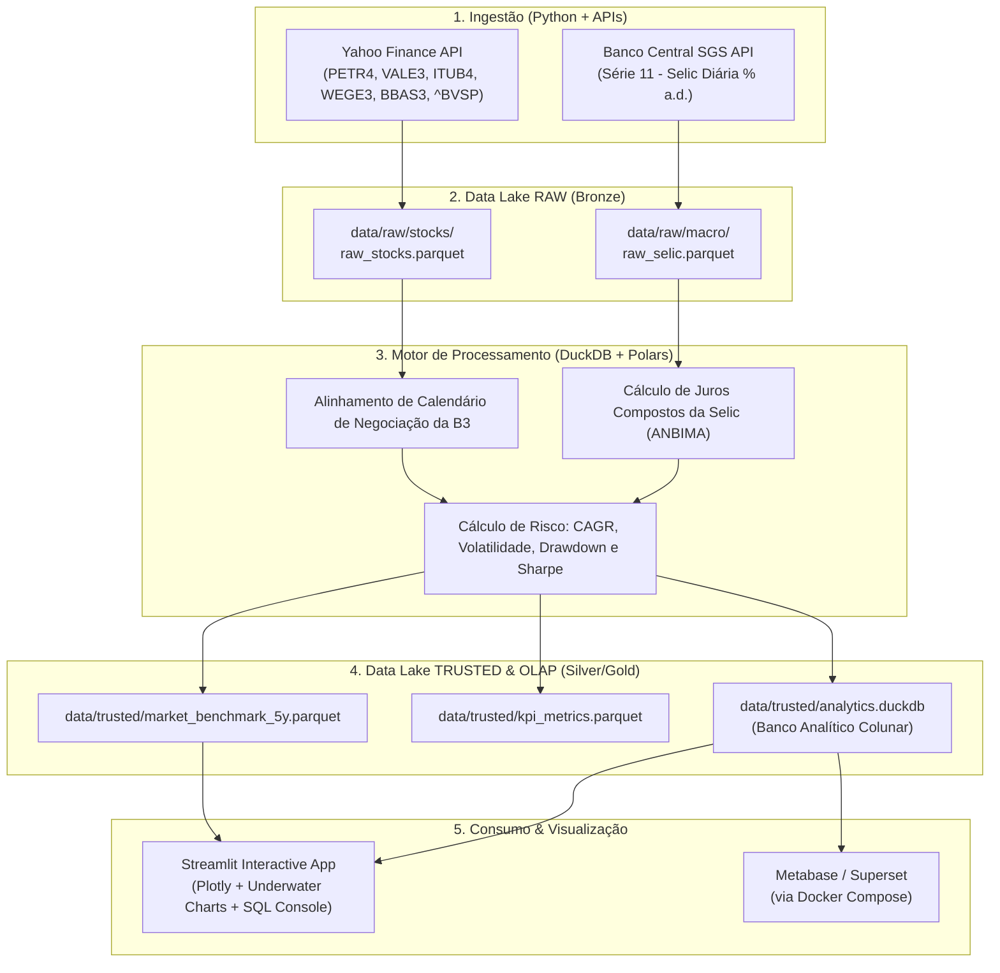

<div align="center">

# 📊 Big Data Finance Pipeline

### *Modern Data Stack Open Source para Análise Financeira Quantitativa e Macroeconômica*

[](https://www.python.org/)
[](https://duckdb.org/)
[](https://pola.rs/)
[](https://parquet.apache.org/)
[](https://streamlit.io/)
[](https://www.docker.com/)
[](LICENSE)

<br/>

> **Data Engineering Pipeline:** Comparativo histórico de 5 anos entre Ativos da B3 (Ações) e Indicadores Macroeconômicos (Selic/Ibovespa) usando Python e arquitetura Open Source.

</div>

---

## 📌 Sumário

* [Visão Geral](#-visão-geral)
* [Arquitetura da Solução (Medallion Lakehouse)](#-arquitetura-da-solução)
* [Estrutura do Data Lake](#-estrutura-do-data-lake)
* [Metodologia Quantitativa](#-metodologia-quantitativa)
* [Resultados do Benchmark (5 Anos)](#-resultados-do-benchmark-5-anos)
* [Dashboard Interativo](#-dashboard-interativo)
* [Guia de Inicialização Rápida](#-guia-de-inicialização-rápida)
* [Infraestrutura Docker (MinIO + Metabase)](#-infraestrutura-docker)
* [Metadados do Repositório](#-metadados-do-repositório)

---

## 🎯 Visão Geral

Este projeto implementa uma esteira completa de Engenharia de Dados (*Modern Data Stack - MDS*) voltada para o mercado de capitais brasileiro (B3) e indicadores macroeconômicos do Banco Central do Brasil (BACEN).

Diferente de pipelines legados que dependem de clusters pesados ou ferramentas proprietárias, esta arquitetura utiliza **Polars** e **DuckDB** para processar centenas de milhares de pontos de dados em milissegundos localmente ou em containers, persistindo tudo no padrão **Medallion Architecture (Bronze/Raw ➔ Silver/Trusted ➔ Gold/Analytics)** em formato colunar comprimido **Apache Parquet (Zstandard)**.

---

## 🏛️ Arquitetura da Solução



---

## 🗄️ Estrutura do Data Lake

Organizado no padrão de camadas de maturidade analítica:

```text
data/
├── raw/                                     # Camada Bronze: dados brutos preservados
│   ├── stocks/
│   │   └── raw_stocks.parquet               # Histórico OHLCV da B3 (yfinance)
│   └── macro/
│       └── raw_selic.parquet                # Histórico diário oficial do BACEN
│
└── trusted/                                 # Camada Silver/Gold: dados tratados & métricas
    ├── market_benchmark_5y.parquet          # Tabela unificada alinhada (8.800+ registros)
    ├── kpi_metrics.parquet                  # Indicadores consolidados por ativo
    └── analytics.duckdb                     # Banco analítico DuckDB pronto para SQL
```

---

## 📐 Metodologia Quantitativa

1. **Alinhamento Temporal:** A Taxa Selic e as ações da B3 compartilham o mesmo calendário de dias úteis, garantindo uma base fidedigna de comparação.
2. **Juros Compostos da Selic (BACEN / ANBIMA):**
   $$\text{Fator Diário}_t = 1 + \frac{\text{taxa\_selic}_t}{100}$$
   $$\text{Fator Acumulado}_T = \prod_{t=1}^T \text{Fator Diário}_t$$
3. **Normalização em Base 100:** Todos os ativos partem do mesmo índice $100.0$ na primeira data de negociação do período.
4. **Métricas de Risco:**
   * **CAGR (Taxa Composta Anual):** $(1 + R_{total})^{1/\text{anos}} - 1$
   * **Volatilidade Anualizada:** $\sigma_{\text{diário}} \times \sqrt{252}$
   * **Max Drawdown:** $\min_{t} \left( \frac{P_t}{\max_{s \le t} P_s} - 1 \right)$
   * **Índice Sharpe Simples:** $\frac{\text{CAGR}_{\text{ativo}} - \text{CAGR}_{\text{Selic}}}{\text{Volatilidade Anualizada}}$

---

## 🏆 Resultados do Benchmark (5 Anos)

*Período: Setembro/2021 a Outubro/2026 (Dados reais extraídos via pipeline)*

| Ativo | Nome | Retorno Total | CAGR Anual | Volatilidade | Max Drawdown | Índice Sharpe |
| :--- | :--- | :---: | :---: | :---: | :---: | :---: |
| **PETR4.SA** | Petrobras PN | <span style="color:#0ecb81">**+631.69%**</span> | **+48.10%** | 31.52% | -39.10% | **1.13** |
| **ITUB4.SA** | Itaú Unibanco PN | <span style="color:#0ecb81">**+171.36%**</span> | **+21.77%** | 25.22% | -28.43% | **0.37** |
| **BBAS3.SA** | Banco do Brasil ON | <span style="color:#0ecb81">**+143.60%**</span> | **+19.21%** | 27.81% | -37.65% | **0.24** |
| **SELIC** | Taxa Selic Acumulada | <span style="color:#f0b90b">**+81.75%**</span> | **+12.51%** | 0.00% | 0.00% | *Risk-Free* |
| **^BVSP** | Ibovespa | <span style="color:#00bcd4">**+79.95%**</span> | **+12.29%** | 17.83% | -20.93% | -0.01 |
| **WEGE3.SA** | WEG ON | <span style="color:#0ecb81">**+46.32%**</span> | **+7.80%** | 29.95% | -44.25% | -0.16 |
| **VALE3.SA** | Vale ON | <span style="color:#0ecb81">**+20.45%**</span> | **+3.74%** | 29.28% | -38.15% | -0.30 |

---

## 🖥️ Dashboard Interativo

O projeto inclui um painel completo em Streamlit com:
* **Curva de Rentabilidade Interativa (Plotly):** Comparação dinâmica em janelas de 1, 2, 3 e 5 anos (% ou Base 100).
* **Underwater Plot (Drawdown):** Gráfico de quedas em relação ao topo histórico ao longo do tempo.
* **Matriz de Correlação de Pearson:** Correlação linear dos retornos diários entre ativos e benchmarks.
* **Console SQL DuckDB:** Permite digitar e executar queries SQL OLAP diretamente sobre o lago de dados pelo navegador.
* **Inspetor do Lake:** Schemas, tamanhos de arquivos e contagem de registros em tempo real.

---

## 🚀 Guia de Inicialização Rápida

### 1. Clonar o Repositório
```bash
git clone https://github.com/mmelquii-dev/BigData.git
cd BigData
```

### 2. Gerenciador de Pacotes (`uv`)
Este projeto é otimizado para o **[uv](https://github.com/astral-sh/uv)** (gerenciador ultra-rápido de Python escrito em Rust):

```bash
# Sincroniza ambiente e instala dependências instantaneamente
uv sync
```

### 3. Execução via CLI (`main.py`)

A aplicação conta com uma interface de linha de comando integrada:

```bash
# 1. Checar integridade das camadas do Data Lake
uv run python main.py status

# 2. Executar pipeline ponta a ponta (Ingestão + Processamento)
uv run python main.py pipeline

# 3. Iniciar o Dashboard Interativo
uv run python main.py dashboard
# Abra no navegador: http://localhost:8501

# 4. Rodar queries SQL diretas no DuckDB via terminal
uv run python main.py query "SELECT ticker, retorno_total_pct, sharpe_ratio FROM kpi_metrics ORDER BY retorno_total_pct DESC"
```

---

## 🐳 Infraestrutura Docker

Para subir o **MinIO** (Data Lake compatível com AWS S3) e o **Metabase** em containers:

```bash
# Subir serviços em background
docker compose -f docker/docker-compose.yml up -d
```

* **MinIO Console:** [http://localhost:9001](http://localhost:9001) (`minioadmin` / `minioadminpassword`)
* **Metabase BI:** [http://localhost:3000](http://localhost:3000)

---

## 🏷️ Metadados do Repositório

Para configurar no menu **About** (canto superior direito no GitHub):

* **Description:**
  > `Data Engineering Pipeline: Comparativo histórico de 5 anos entre Ativos da B3 (Ações) e Indicadores Macroeconômicos (Selic/Ibovespa) usando Python e arquitetura Open Source.`
* **Topics / Tags:**
  `data-engineering`, `python`, `finance`, `b3`, `duckdb`, `metabase`, `data-lake`

---

## 📄 Licença

Distribuído sob a licença **MIT**. Consulte o arquivo [`LICENSE`](LICENSE) para mais detalhes.

<div align="center">
Desenvolvido por <b>mmelquii-dev</b> 🚀
</div>
